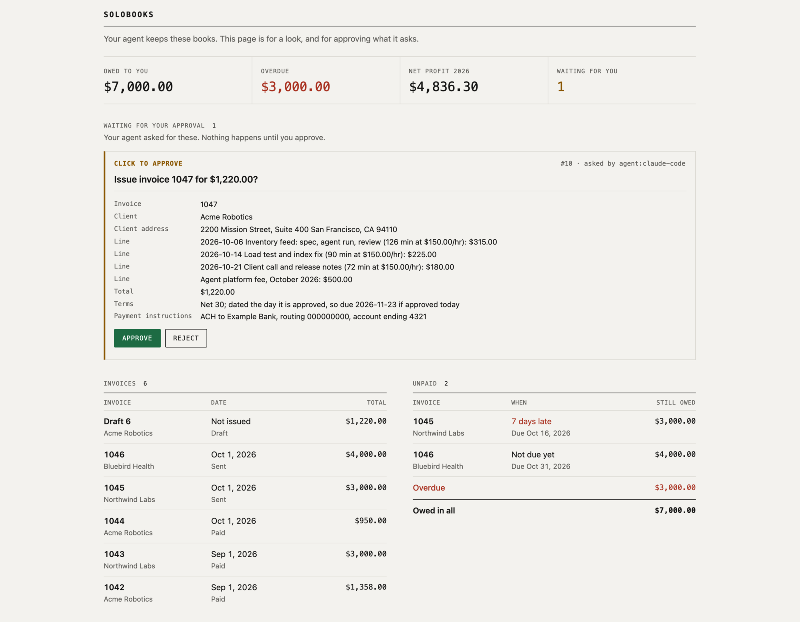
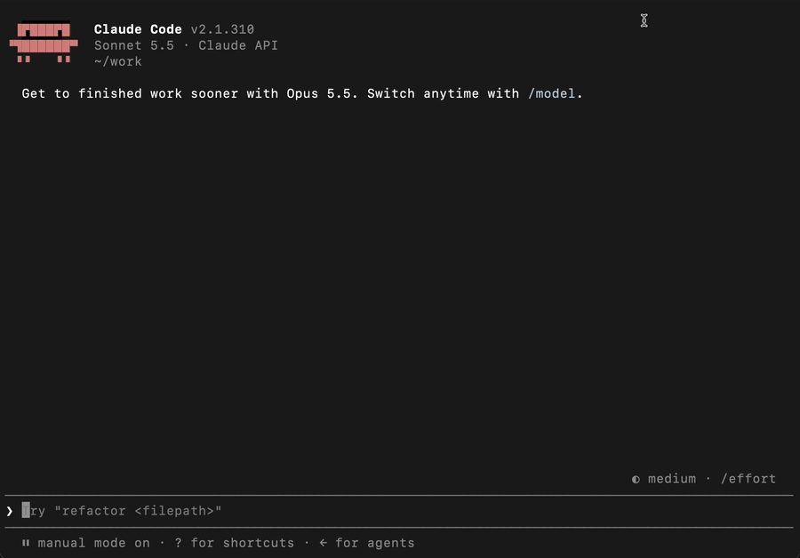
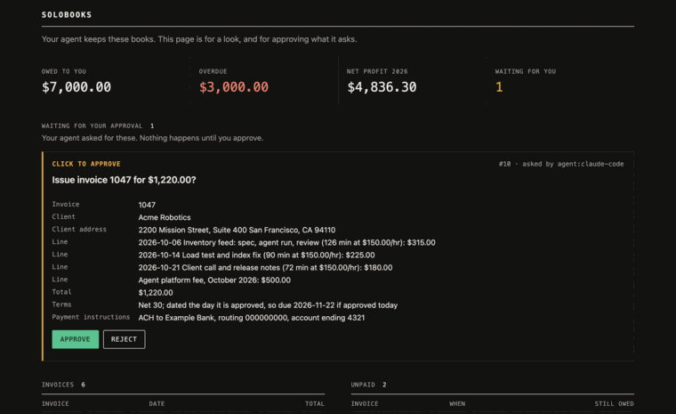

# solobooks

Books for US solo consultants, kept by the coding agent you already use. You tell Claude Code or Codex what happened ("Acme paid", "bill everyone for October", "here's my bank statement"), and solobooks keeps a double-entry ledger, numbers your invoices, makes the PDFs and holds every invoice until you approve it.

It runs on your machine. It sends no email, connects to no bank, holds no passwords and has no AI inside. Your agent does the talking and the outside world; solobooks holds the math and the rules.

<picture>
  <source media="(prefers-color-scheme: dark)" srcset="media/page-dark.png">
  
</picture>

## A month, start to finish

You ask your agent to bill a client. It drafts the invoice from your logged time and recurring fees, shows you every line, and asks to issue it. Nothing reaches the client yet:



You approve on the local page that `solobooks serve` opens, with a click or with Touch ID, depending on the level you set for that kind of action. Your agent can't approve for you, and no tool lets it:



Then your agent makes the PDF and the email text, leaves the email as a draft in your mail, and records it as sent once you send it. When the client pays, you tell your agent, or hand it the bank statement, and the payment lands against the invoice.

## Who it's for

One person, a US sole proprietor or single-member LLC, who bills clients hourly, by fixed-fee milestones, on a monthly retainer, or a mix, and already works through a coding agent. If you'd rather tell an agent what happened than click through a books app, this is for you.

It isn't for teams, payroll, inventory, multi-currency, accrual accounting, or anyone who wants a web app. It keeps one US business, in dollars, on one machine.

## Install

Paste this into your agent:

```text
Install solobooks by following https://raw.githubusercontent.com/kkeeling/solobooks/main/INSTALL.md
```

Your agent installs the app, connects itself, checks the connection, and then sets you up by asking for what an invoice needs: your business details, how clients pay you, your next invoice number, and your first client. If you'd rather do it by hand, pick your agent below.

<details>
<summary><b>Claude Code</b></summary>

Install the app, then either let it connect itself:

```sh
curl -fsSL https://raw.githubusercontent.com/kkeeling/solobooks/main/install.sh | sh
~/.local/bin/solobooks setup
~/.local/bin/solobooks doctor
```

or, to get updates through Claude Code, install the plugin, which carries the MCP server and the skill. Install it before running setup: setup sees the plugin and adds no second connection, and still picks your books folder.

```sh
curl -fsSL https://raw.githubusercontent.com/kkeeling/solobooks/main/install.sh | sh
claude plugin marketplace add kkeeling/solobooks
claude plugin install solobooks@solobooks
~/.local/bin/solobooks setup
~/.local/bin/solobooks doctor
```

Restart Claude Code so it loads the solobooks tools.

</details>

<details>
<summary><b>Codex</b> (and the ChatGPT desktop app, which shares its config)</summary>

```sh
curl -fsSL https://raw.githubusercontent.com/kkeeling/solobooks/main/install.sh | sh
~/.local/bin/solobooks setup
~/.local/bin/solobooks doctor
```

setup adds `[mcp_servers.solobooks]` to `~/.codex/config.toml` and puts the skill in `~/.agents/skills`. Restart Codex.

</details>

<details>
<summary><b>Claude Desktop</b></summary>

Same three commands as above. setup adds solobooks to `claude_desktop_config.json`; quit and reopen Claude Desktop. Desktop doesn't read skill folders, so the tools' own descriptions guide it.

</details>

<details>
<summary><b>Any other local agent</b> (Gemini CLI, Cursor, VS Code, OpenCode, Amp, Cline, Goose, Grok Build, Muse Code, Devin CLI)</summary>

Install the app with the installer above and run `solobooks setup` to pick the books folder. Then register a stdio MCP server in your agent with the command `~/.local/bin/solobooks` and the argument `mcp`. If your agent's config expects `npx`, use `npx -y solobooks mcp` instead. Point it at the skill in `~/.agents/skills/solobooks`, which most of these agents read already.

</details>

## What it keeps

- **Clients and terms:** hourly rates, fixed-fee milestones, monthly retainers or any mix, with per-client time rounding and payment terms.
- **Invoices:** numbered with no gaps, PDFs and email text ready for your agent to send, credit notes, voids, overdue reminders, and past invoices brought in with their original numbers.
- **Money:** payments recorded gross plus fee (so it matches your 1099-K), refunds, client credit, bank and card statements matched line by line, and your own money (draws, contributions, transfers) kept out of the P&L.
- **Expenses:** receipts attached, pass-through costs billed on to clients, each on its Schedule C line.
- **Year end:** a cash-basis P&L by Schedule C line, sales tax charged and collected, a mileage log at the IRS rate, home office, estimated taxes, and contractors, plus a CSV of the year for your accountant.
- **Approvals:** set per kind of action. Let the agent decide, click to approve, or require your passkey. Approvals happen on the local page; your agent's own "run this tool?" prompt is not the approval.
- **Safety:** daily backups to a folder you choose, a backup before every upgrade, and a warning if the books sit in a synced folder.

## Billing your agent time

solobooks stores time; it never tracks it. If you bill for the time you spend directing Claude Code and Codex, the optional **agent-time add-on** counts it from their session logs on your machine, by a fixed rule: from each of your own messages until 10 minutes after your last action, with parallel sessions merged so no hour bills more than 60 minutes. It asks once which project folders belong to which client, previews the hours before writing anything, and can't bill a day twice.

In Claude Code: `claude plugin install solobooks-agent-time@solobooks`. For other agents, copy [addons/agent-time/skills/bill-agent-time](addons/agent-time/skills/bill-agent-time) into `~/.agents/skills/`. Then ask your agent to "bill my agent time for October". Setup never installs it on its own.

## Supported agents

Agents that run on your machine: Claude Code, Claude Desktop, Codex, the ChatGPT desktop app, Grok Build, Meta Muse Code, Gemini CLI, Cursor, VS Code with Copilot, OpenCode, Amp, Cline, Goose and Devin CLI. solobooks is tested with Claude Code and Codex on every release.

## Not supported

Cloud-only agents can't reach books stored on your machine:
claude.ai and ChatGPT on the web and on phones, Grok on the web (unless local execution is on), Meta's Muse app, and cloud agents such as Devin's and Amp's hosted runs.

## Privacy

Your books stay on your disk, in one folder you own (`~/solobooks` unless you choose another), and solobooks never sends them anywhere.
Whatever your agent reads from them, though, goes to that agent's model vendor as part of the conversation, the same as any file you show it.

## License

MIT. See [LICENSE](LICENSE).

solobooks is not tax or accounting advice.
It keeps records; what to claim, and what you owe, is a question for your accountant.
